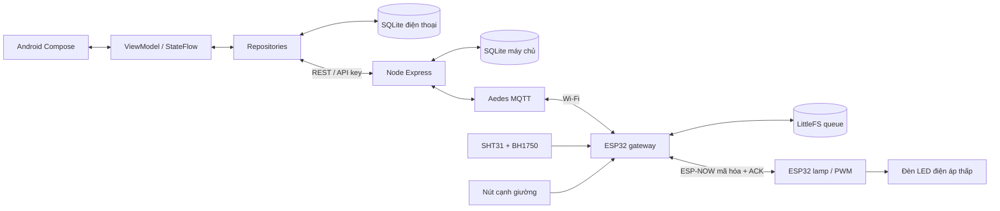

# Kiến trúc và giao thức



## Android

`data` chứa model, SQLiteOpenHelper, HTTP API và các repository. `SleepViewModel` điều phối coroutine và StateFlow; `ui` tách theo màn hình; `Navigation Compose` quản lý5tab, settings, detail và edit. Dùng SQLiteOpenHelper trực tiếp thay Room để giữ ít dependency, dễ đọc cho nhóm. Không cần quyền storage/location/Bluetooth; chỉ INTERNET.

Live và demo có hai tập phiên khác nhau trong cùng database. Ghi cục bộ trước với `dirty=true`; đồng bộ khi app mở và có kết nối, định kỳ5giây. Khi app đóng, dữ liệu cục bộ được giữ và sẽ gửi lần mở tiếp theo; chưa có WorkManager đồng bộ nền. Máy chủ hoạt động riêng vẫn tiếp nhận ESP32 khi app đóng.

`version` cho từng phiên dùng để tránh âm thầm ghi đè khi nút thiết bị và app cùng sửa. Nếu HTTP trả lời mất nhưng nội dung đã lưu, retry cùng nội dung trả lại phiên hiện có. Xung đột khác trả409; giữ bản cục bộ để người dùng đối chiếu. Cài đặt → Tải lại máy chủ có xác nhận trước khi bỏ sửa đổi cục bộ.

## REST

Mọi endpoint `/api/*` cần header `X-API-Key`, ngoại trừ `/api/time` chỉ trả thời gian. `/health` cho kiểm tra dịch vụ. Timestamp dùng epoch **milliseconds**, lưu UTC; app trình bày giờ địa phương. Lịch đèn mặc định UTC+7.

| Method | Route | Nội dung |
|---|---|---|
| GET | `/api/sessions` | Tất cả phiên và tombstone |
| PUT | `/api/sessions/:id` | Ghi toàn bộ phiên, có `version` |
| GET | `/api/environment?from=...` | Mẫu và events từ thời điểm chỉ định, mặc định24giờ; tối đa32ngày |
| GET | `/api/detail?start=...&end=...` | Mẫu/events trong đúng phiên |
| GET / PUT | `/api/settings` | Ngưỡng và lịch đèn |
| POST | `/api/commands` | `{ "brightness": 40 }` → `id`, pending |
| GET | `/api/commands/:id` | pending / applied / failed / expired |

## MQTT

Username `bedroom-01`, password từ `DEVICE_PASSWORD`; cấu hình trên gateway phải khớp. Broker giới hạn topic publish/subscribe của thiết bị. Không dùng broker công cộng.

| Topic sau `sleep/bedroom-01/` | Chiều | Dữ liệu chính |
|---|---|---|
| `telemetry` | ESP32 → server | id,timestamp,source,temperature,humidity,light; số thiếu dùng null |
| `event` | ESP32 → server | id,timestamp,source,kind,value |
| `ack` | server → ESP32 | id,ok,error nếu có; chỉ ACK sau lưu DB |
| `status` | ESP32 → server | online,lampOnline,brightness,timeSynced,queue; last will offline |
| `config` retained | server → ESP32 | settings,sleeping,version |
| `command` không retained | server → ESP32 | id,brightness,expiresAt |
| `command-ack` | ESP32 → server | id,ok,detail |

Ví dụ telemetry:

```json
{"id":"chip_boot_000001","timestamp":1795071600000,"source":"device","temperature":25.7,"humidity":61.2,"light":35.4}
```

ID giữ nguyên khi gửi lại. SQLite có khóa chính chống trùng. Mẫu đến chậm được xếp theo timestamp, không làm số hiện tại quay về mẫu cũ. Trạng thái gateway online hết hạn sau30giây không có status. `applied` chỉ xuất hiện sau khi gateway nhận ACK đúng boot/sequence/brightness từ lamp; hết15giây lệnh server chuyển expired. Lamp kiểm tra MAC, magic, version, range và sequence; callback radio chỉ đưa vào queue, phần loop mới đặt PWM.

## Lưu trữ thiết bị và khôi phục

- Wi-Fi, cặp MAC/khóa, kênh: NVS Preferences. Lịch/ngưỡng và trạng thái ngủ cũng lưu NVS.
- Một bản ghi LittleFS được ghi vào tệp tạm, flush, rename trước khi xem là đã nhận. ACK thành công mới xóa. Hỏng JSON được đổi đuôi `.bad` để kiểm tra; dữ liệu bị server từ chối được log và bỏ khỏi queue để tránh kẹt vĩnh viễn.
- Telemetry15s online/60s offline; queue500mẫu thường, thêm12vịtrí sự kiện. Dừng nhận thêm khi đầy hoặc flash hết, không âm thầm xóa bản ghi cũ. Giới hạn thực tế cần đo trên bo và partition đang dùng.
- Khi có hàng đợi offline, không áp trạng thái ngủ retained cũ đè lên nút vật lý. Sau khi gửi hết, subscribe lại config để nhận trạng thái máy chủ mới nhất.
- Lịch bình minh xử lý qua0giờ, manual trong đoạn bình minh tạm chặn phần còn lại của đoạn đó; hôm sau tự kích hoạt lại. Bắt đầu/kết thúc ngủ mới cũng bỏ override. Thay đổi trạng thái trong app cần tới server rồi gateway; khi toàn bộ đường mạng mất, dùng nút vật lý.

## Bổ sung phiên bản 2: giao diện và trợ lý

UI Compose dùng bảng màu xanh đêm/tím dịu, token dùng chung trong `Theme.kt`, các thành phần/biểu đồ trong `Components.kt` và chuyển động trong `Motion.kt`. Animation tôn trọng lựa chọn trong app và cài đặt Android. Chat là route riêng để giữ năm tab chính dễ dùng.

Bản 2.1 tách `Atmosphere.kt` (nền, cực quang, sao), `Glass.kt` (thẻ kính/ánh sáng) và `Motion.kt` (quỹ đạo, halo đèn, chuyển cảnh). Trạng thái chuyển động liên tục được đọc trong draw scope thay vì recompose nội dung mỗi frame. `SleepTheme` quan sát lifecycle để dừng các vòng animation khi Activity không RESUMED. Không dùng WebView, ảnh tải ngoài hoặc thư viện mới. Nguồn demo/live vẫn lưu và truyền AI đúng loại; nhãn nguồn tập trung trong Cài đặt thay vì banner ở mọi màn hình.

`ChatViewModel` độc lập với mutex đồng bộ IoT, nên câu hỏi AI đang chờ không khóa nhật ký hoặc thiết bị. `AssistantApi` có timeout và ngắt kết nối khi hủy; token thế hệ loại phản hồi cũ khi đổi server/nguồn hoặc xóa hội thoại. SQLite cache lưu chat theo hash của server + khóa kết nối + demo/live, bản 4.2 cho phép cá nhân hóa Gemini bằng tổng hợp bảy ngày và môi trường theo cài đặt. Chuyển URL được giữ hội thoại khi serverId xác thực trùng nhau; tắt cá nhân hóa không tự xóa lịch sử cũ.

`GET /api/ai/status` và `POST /api/ai/chat` dùng cùng xác thực API. Backend `assistant.js` kiểm tra trường, giới hạn dung lượng/tần suất, chỉ cho role user/assistant từ client, thêm chỉ dẫn hệ thống cố định và gọi provider từ cấu hình máy chủ. Context chỉ chứa trường được cho phép; không đọc toàn bộ DB tự động. Không lưu nội dung chat phía server. Không có tool AI điều khiển IoT. Cấu hình, giao thức provider và giới hạn trong [AI.md](AI.md).

## Phạm vi triển khai hiện tại

Bản 4.2 hỗ trợ **một người/một phòng**, Android và XIAO truy cập HTTPS qua Cloudflare Quick Tunnel tới máy tính. Gateway tách khóa app/thiết bị và giới hạn quyền; firmware kiểm tra CA. Đây là URL tạm, chưa có domain cố định, tài khoản nhiều người, phân quyền nhiều phòng hoặc OTA. Nhắc nhở dùng lịch cục bộ Android, không dùng Web Push. Chi tiết trong [REMOTE-ACCESS.md](REMOTE-ACCESS.md). Về phân tích, app đối chiếu số đo cùng phiên và mô tả thống kê; chưa suy ra quan hệ nhân quả hay điểm sức khỏe từ cảm biến phòng.
